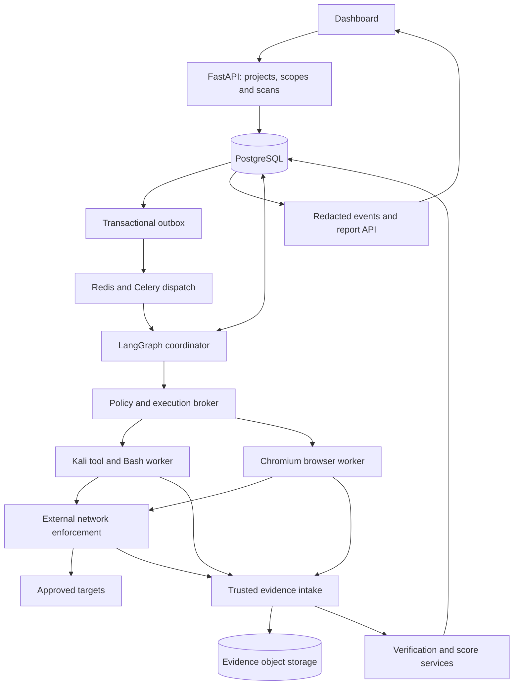
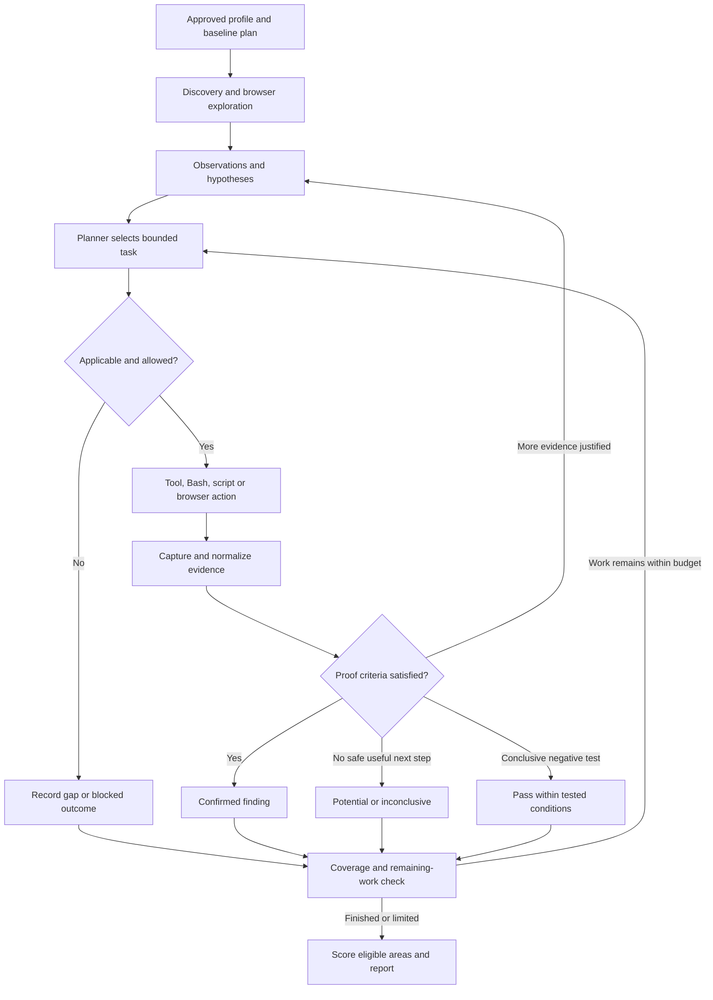

# ScopeLens — Comprehensive Implementation Plan

**Owner:** Aditya Pratap Singh  
**Version:** 1.1 · 24 September 2026  
**Status:** Build plan and acceptance gates; no implementation or benchmark results claimed.  
**Primary specification:** `ScopeLens_Project_Specification.md`

Read the project specification for required product behavior, scope, the full catalogue, confirmation rules and pilot scoring. This plan contains the architecture, technology decisions, work packages, testbeds, metrics and operating sequence needed to implement it. It incorporates the previous architecture audit; no separate audit document is needed in the project folder. Sections 1–12 explain the design; §13 defines measurable acceptance, §14 gives ordered milestones, §15 defines labs, §16 model portability, and §17–§18 provide engineering contracts and the starting runbook.

ScopeLens is the selected name. Model providers remain interchangeable. Start in owned, isolated labs, then explicitly registered owned sites. Keep numeric category/field scores as **Pilot assessment score — uncalibrated**, with severity, coverage and eligibility beside them. Build the first external unauthenticated release before the authenticated and advanced profiles. Name/domain/trademark availability has not been investigated.

## Contents

- [1. Implementation direction](#1-implementation-direction)
- [2. Architecture requirements carried into implementation](#2-architecture-requirements-carried-into-implementation)
- [3. Current-source findings that changed the recommendation](#3-current-source-findings-that-changed-the-recommendation)
- [4. Final architecture](#4-final-architecture)
- [5. Technology decisions](#5-technology-decisions)
- [6. MCP adoption audit](#6-mcp-adoption-audit)
- [7. Browser and computer-use decision](#7-browser-and-computer-use-decision)
- [8. Kali, Bash and generated scripts](#8-kali-bash-and-generated-scripts)
- [9. Scanner and repository selection](#9-scanner-and-repository-selection)
- [10. Skills we can use](#10-skills-we-can-use)
- [11. Recovery, cancellation and observability](#11-recovery-cancellation-and-observability)
- [12. Evidence and pilot scoring requirements](#12-evidence-and-pilot-scoring-requirements)
- [13. Validation and measurable acceptance](#13-validation-and-measurable-acceptance)
- [14. Ordered implementation milestones](#14-ordered-implementation-milestones)
- [15. Testbed portfolio and benchmark harness](#15-testbed-portfolio-and-benchmark-harness)
- [16. Provider-flexible model integration](#16-provider-flexible-model-integration)
- [17. Engineering layout and contracts](#17-engineering-layout-and-contracts)
- [18. Starting runbook and completion checklist](#18-starting-runbook-and-completion-checklist)
- [19. Source register and research status](#19-source-register-and-research-status)

## 1. Implementation direction

Proceed with a Python/FastAPI application, an explicit LangGraph workflow, PostgreSQL as the durable record, Redis/Celery for dispatch, local Chromium controlled through Playwright, and isolated workers containing a curated Kali toolset. Build the investigation logic, execution policy, evidence model, verification, coverage and scoring. Reuse mature scanner engines. Provide typed functions, bounded Bash and a separately governed custom-script path.

The design supports the intended loop: discover → form a hypothesis → select a relevant action → execute → examine evidence → verify or investigate further. This applies to browser behavior, API results, configuration weaknesses and suspected vulnerabilities generally. Open ports are only one optional input.

**Design conclusion:** this is a coherent implementation baseline for an authorized web assessment MVP, provided the controls below are actually built and validated. It is not yet a proven scanner. Documentation review cannot establish detection accuracy, containment, cancellation performance or production readiness. No live target was scanned, no candidate repository was executed, and no end-to-end integration benchmark was performed in this audit.

Required capabilities are adaptive follow-ups, browser interaction, category/field scoring, reusable tools, Bash flexibility, provider-flexible models and plain-English reports. The implementation defaults below make those requirements concrete. Broader authenticated and advanced capabilities remain separately gated milestones.

## 2. Architecture requirements carried into implementation

| Priority | Design concern | Required implementation |
|---|---|---|
| P0 | Frontend exploration and agent execution need explicit support beyond HTTP-only crawling. | Build bounded browser interaction in MVP; support typed tools and isolated Bash. |
| P0 | Arbitrary scripts can bypass a convenience proxy or browser filter. | Enforce networking outside workers; distinguish HTTP-aware policy, real TLS measurement and explicitly approved raw service discovery. |
| P0 | A generated script can print a fabricated success result. | Require trusted runner/gateway/browser evidence before confirmation; script output is an observation. |
| P0 | Retries can duplicate a check or state change. | Durable task ledger, idempotency keys, leases/fencing, reconciliation and outcome-unknown state. |
| P0 | Multiple agents can interfere with one browser session. | One controller/lease per browser session; serialize actions within a context. |
| P0 | Some attractive MCP integrations expose more authority than the product needs. | Curate servers/tools, isolate them, and disable target-provided tools and automatic MCP importing. |
| P1 | Some commonly recommended repositories are no longer the maintained integration path. | Use current integration interfaces and version compatibility tests; do not copy old quickstarts blindly. |
| P1 | Checkpoint persistence and graph-private state do not enforce data privacy. | Dedicated redacted dashboard events; credentials remain outside graph/model state. |
| P1 | The custom score is reproducible but uncalibrated. | Keep the formula versioned and label it as observed posture; validate against expert-reviewed cases. |
| P1 | The catalogue counts families, subchecks and overlaps. | Implement canonical test IDs, per-instance coverage and published support status. |

P0 means required before the corresponding capability is enabled against a customer target. P1 means required before a public product launch or before advertising that capability.

## 3. Current-source findings that changed the recommendation

- The former `langchain-mcp-adapters` repository is archived and directs users to `langchain.mcp`. Current LangChain docs describe `MCPAdapter` under `langchain[mcp]`, marked beta. Keep this behind a small internal interface and pin a tested combination. [S02](https://github.com/langchain-ai/langchain-mcp-adapters)[S03](https://docs.langchain.com/oss/python/langchain/mcp)
- Browserbase's old self-hosted MCP reference repository is archived. It is not the recommended maintained dependency; current hosted Browserbase and Stagehand are separate options. [S06](https://github.com/browserbase/mcp-server-browserbase)
- Playwright MCP's origin filters are not a security boundary and do not cover redirects. Its current configuration also supports page-registered WebMCP tools. Disable that target-provided tool surface for assessments and retain external enforcement. [S04](https://github.com/microsoft/playwright-mcp)
- ZAP has an official MCP Integration add-on. Its importer can call discovered tools using placeholder inputs, including through spider integration. Use ZAP Automation Framework/API for MVP and leave that add-on out of default customer images until separately assessed. [S08](https://www.zaproxy.org/docs/desktop/addons/mcp-integration/)
- Current LangGraph documentation warns that private graph channels can appear in values streaming. The frontend must receive an intentionally constructed event schema. [S10](https://docs.langchain.com/oss/python/langgraph/graph-api)
- Celery documentation discourages programmatic use of task termination through worker revocation. Cancel through the scan controller and dedicated execution supervisor. [S11](https://docs.celeryq.dev/en/stable/userguide/workers.html)

These are source observations as of the research date, not claims that a particular package set has been installed or tested here.

## 4. Final architecture

### 4.1 Application, workflow and execution boundaries

The diagram is the default HTTP assessment lane. Dedicated TLS and optional host-service lanes are described in section 8. Redis dispatches notifications; it does not own scan truth. PostgreSQL owns task/scan state and budget accounting. A trusted supervisor outside the untrusted workers handles process lifecycle, run identity and evidence collection. Workers do not receive database credentials or general control-plane access.

Use one backend codebase with clear modules and separately deployed worker processes. Start with one active scan, with limited parallelism inside it. Do not begin with a large microservice fleet or one operating-system process for every conceptual agent.

### 4.2 Adaptive investigation workflow

Keep two ledgers: mandatory profile coverage and adaptive investigations. Allocate a protected portion of the budget to baseline checks so interesting findings do not consume the whole scan. Every follow-up records the hypothesis, supporting observation, expected evidence, alternative explanation and stop condition. A useful action must produce new evidence, reduce uncertainty or complete a required check. Repeated identical work requires an explicit reason.

Defaults to tune in the pilot: no more than three follow-up rounds per hypothesis; one controller-level retry for a transient read-only failure; no blind retries after an uncertain side effect. These are planning defaults, not assumptions that every weakness can be resolved in three rounds.

### 4.3 Agent and service responsibilities

| Role | Implementation | Responsibility and limit |
|---|---|---|
| Coordinator | LangGraph plus deterministic scheduling | Owns scan state, baseline coverage, routing and budget allocation. |
| Investigation planner | LLM with typed output | Chooses relevant registered checks; can propose custom tasks, cannot expand authority. |
| Browser specialist | LLM plus browser controller | Explores UI state using DOM/accessibility data and visual fallback; observes network behavior. |
| Web/API specialist | LLM plus tool adapters | Connects observations to appropriate input, response and API hypotheses. |
| Configuration/service specialist | Primarily deterministic tools; LLM for contextual selection | TLS, headers, cookies, public exposure and optional approved service inventory. |
| Evidence verifier | Registered rules, reproducibility checks and optional LLM challenge | Confirms only supported claims; another model agreeing is not independent proof. |
| Report writer | LLM operating on structured verified results | Explains findings and limitations; cannot alter evidence, severity rules or scores. |
| Scoring/coverage service | Deterministic Python | Applies versioned rubric, deduplication and eligibility gates. |

Logical roles can share a process and model. Models are replaceable behind one interface. Select a vision-capable model for browser fallback and a model with reliable schema/tool use for planning; use deterministic code where no reasoning is needed. No model is declared “best” without testing representative tasks, cost, latency and refusal/error behavior on the authorized benchmark.

### 4.4 State and records

Persist tenant/project/scan IDs, scope revision/expiry, profile and scoring versions, model/prompt/skill/tool versions, baseline plan, hypothesis ledger, browser session handles, remaining budgets, task/run IDs, cancellation epoch, evidence references and coverage outcomes. Store compact structured summaries in graph state; large response bodies and screenshots belong in evidence storage.

Each task carries a canonical test ID or experimental marker, normalized target, input/role context, requested action, impact class, capability reference, request/time limits, prerequisite evidence, expected proof and retry policy. Tool results include observations and artifact references; they cannot set a trusted `confirmed` decision themselves.

## 5. Technology decisions

| Layer | Use now | Reason / later alternative |
|---|---|---|
| Backend | Python + FastAPI + typed schemas | Matches the team and supports explicit contracts. |
| Orchestration | LangGraph | Explicit branches, state and mixed deterministic/agentic nodes. [S01](https://docs.langchain.com/oss/python/langgraph/overview) |
| Model integration | Selected LangChain components behind our provider adapter | Direct OpenAI, OpenRouter and qualified open-model endpoints; test capabilities and fallback policy (§16). |
| Dispatch | Redis + Celery | Use dispatch plus a PostgreSQL ledger; do not treat queue delivery as exactly once. |
| Durable records | PostgreSQL | Scan/task truth, checkpoints, leases, outbox and score history. |
| Evidence | Encrypted object storage | Separate access controls and retention; worker upload capability scoped to its run. |
| Browser | Playwright Python + local Chromium | Core executor with controlled action/network capture. [S05](https://playwright.dev/docs/browser-contexts) |
| Tool environment | Custom Kali-based image plus dedicated browser image | Bake dependencies into pinned release images; record all versions. [S12](https://www.kali.org/docs/containers/using-kali-docker-images/) |
| UI | React/TypeScript with FastAPI API | Scorecards, coverage, evidence drill-down and redacted SSE progress. |
| Tracing | Structured application events and redacted agent/tool traces | A tracing vendor is optional; avoid adding a launch dependency. |
| MCP | Optional curated adapter boundary | Useful interoperability; direct adapters remain the main execution path. |
| Skills | Reviewed Agent Skills-compatible knowledge packs | Load relevant guidance; enforcement remains application code. [S13](https://agentskills.io/specification) |

Kubernetes, a second workflow engine, a vector database and a large multi-agent framework stack are not launch requirements. Revisit a durable workflow platform if multi-day approval waits, recovery complexity or job volume justify it. Do not run Celery and another workflow engine as competing owners of the same scan.

## 6. MCP adoption audit

| Candidate | Decision | Integration requirements |
|---|---|---|
| Microsoft Playwright MCP | Optional local sidecar / development integration | Wrap permitted actions, preserve per-scan sessions, disable page-provided tools; use external containment. Direct Playwright remains simpler for the core service. [S04](https://github.com/microsoft/playwright-mcp) |
| Chrome DevTools MCP | Optional diagnostic tool | Useful network/console investigations; overlaps with Playwright. Never let two controllers manipulate the same tab. Review telemetry before customer use. [S15](https://github.com/ChromeDevTools/chrome-devtools-mcp) |
| ZAP official MCP add-on | Evaluate later | Powerful control surface and import side effects; AF/API is the launch path. [S08](https://www.zaproxy.org/docs/desktop/addons/mcp-integration/) |
| Current LangChain MCPAdapter | Preferred LangChain integration if MCP is needed | Beta interface: isolate behind an adapter and pin compatibility. Avoid the archived predecessor. [S02](https://github.com/langchain-ai/langchain-mcp-adapters)[S03](https://docs.langchain.com/oss/python/langchain/mcp) |
| Official MCP Python SDK | Reference/custom adapter option | Use when building a narrow server or needing direct protocol control; test protocol negotiation with actual servers. [S16](https://github.com/modelcontextprotocol/python-sdk) |
| Browserbase hosted MCP / current SDK | Later hosted-browser option | Provider network and evidence guarantees must pass the same tests as local execution. Do not use the archived reference server as the maintained base. [S06](https://github.com/browserbase/mcp-server-browserbase)[S17](https://www.browserbase.com/templates/playwright) |
| LangChain documentation MCP | Development-time, read-only reference | Helpful for engineers consulting framework docs; no customer evidence should be sent in documentation queries. [S03](https://docs.langchain.com/oss/python/langchain/mcp) |
| Arbitrary shell/security MCP bundles | Do not auto-adopt | A bundle of commands is not a verified assessment system. Review individual functions and expose only required capabilities. |

MCP standardizes tool communication; it does not provide tenant isolation, vulnerability verification or a sandbox. Browser identity is an explicit application resource bound to tenant, scan, role, controller lease and expiry. Never treat an MCP connection or an opaque state handle as authorization. Use the negotiated protocol's current lifecycle correctly; do not rely on old per-call session assumptions. [S16](https://github.com/modelcontextprotocol/python-sdk)[S18](https://modelcontextprotocol.io/docs/2026-07-28/tutorials/security/security_best_practices)

Review server identity, tool names/schemas, return-size limits, authentication, token audience and transport. Pin the allowed tool surface per release and reject unexpected schema changes. Do not pass customer bearer tokens through to unrelated servers. Tool descriptions, resources and results are untrusted input. A discovered target MCP endpoint is inventory until that target capability is explicitly part of the approved assessment.

## 7. Browser and computer-use decision

Use a hybrid browser agent: DOM/accessibility-driven actions first, screenshot/coordinate actions where necessary. A browser provider adapter exposes create-session, observe, act, capture-evidence and close operations. It preserves scope and evidence contracts when switching from local Chromium to hosted execution.

| Option | Decision | Why |
|---|---|---|
| Playwright + Chromium | Core | Precise actions and instrumentation; retains control over our investigation loop. [S05](https://playwright.dev/docs/browser-contexts) |
| Playwright MCP / CLI | Optional interface | Useful integration with agents and shell workflows; it must pass through the same session controller. [S04](https://github.com/microsoft/playwright-mcp)[S19](https://github.com/microsoft/playwright-cli) |
| Stagehand | Pilot alternative for navigation | Current upstream supports Python and local/hosted operation. Evaluate marginal navigation benefit before adding another reasoning layer. [S20](https://github.com/browserbase/stagehand) |
| browser-use | Pilot alternative browser specialist | Python ecosystem fit; benchmark it against the simpler custom loop. Do not stack multiple autonomous controllers. [S21](https://github.com/browser-use/browser-use) |
| Browserbase | Later provider | Adopt only after session, scope, retention and cancellation equivalence is demonstrated. [S17](https://www.browserbase.com/templates/playwright) |
| Lightpanda | Optional discovery optimization | Not the reference engine for pixel-accurate rendering or browser-security confirmation. [S22](https://lightpanda.io/docs/core-concepts/architecture-overview) |

Required browser behavior:
- One active action owner per context; separate contexts for identities and separate sandbox/process boundaries for unrelated scans as appropriate.
- Observe menus, dialogs, tabs, frames, forms, navigation and resulting API calls. Bound depth/state count/action count and detect navigation loops.
- Approve action intent, not only HTTP method. A benign-looking click can submit a purchase or message.
- Record state before/after an action, page/frame identifiers, screenshot/DOM references and relevant network events. A screenshot alone does not prove server authorization failure.
- Record whether service workers, caches or browser settings differ from the real application. Instrumentation gaps become coverage limitations. Browser contexts are session separation, not a hostile-workload sandbox. [S05](https://playwright.dev/docs/browser-contexts)
- Recreate expired browser sessions only through known replayable navigation steps. Never blindly replay prior form submissions.
- Keep browser security protections active. Diagnostics that deliberately alter TLS/cookie/browser policy run separately and cannot support claims about ordinary-user behavior without qualification.
- Hosted execution is not approved merely because CDP connects successfully. Prove scope enforcement, action logging, evidence access, role isolation and cancellation first.

## 8. Kali, Bash and generated scripts

### 8.1 Worker images

Use a custom Kali image built in CI, with a tool manifest and immutable image digest. The official base image does not include the default tool metapackage automatically. Install only selected dependencies and freeze an internally tested snapshot. [S12](https://www.kali.org/docs/containers/using-kali-docker-images/)

Keep Chromium in a separate dedicated worker image. Give untrusted jobs no host filesystem mounts, privileged container mode, container-engine socket, broad cloud credentials or route to control-plane services. For customer jobs and generated code, use a dedicated worker VM or an equivalently evaluated isolation boundary; a Docker container alone is not the whole boundary.

### 8.2 Three execution paths

1. **Typed functions:** common checks with validated inputs and stable output contracts.
2. **Bash:** installed-tool help, supported parameter adaptation, local result processing and approved command composition. Every invocation has a task/run record, budgets and artifact limits. In the production profile, networked Bash invokes reviewed checks with permitted parameter ranges/configurations; arbitrary new networked commands use the lab/staging path. Destination/path restrictions alone cannot prevent harmful content in an otherwise allowed request.
3. **Custom scripts:** generated Python/Bash for bounded investigation gaps. Proposed default: automatic sandbox-local analysis; networked custom verification first in approved lab/staging. Production uses reviewed registered checks until custom-code containment and evidence validation pass their release gates.

This preserves requested flexibility without treating Bash as a permission override. Validation cannot prove arbitrary code harmless. Independent resource and network containment is required even after review. No runtime installation from arbitrary repositories; missing capabilities become an integration request. Record script content hash and interpreter/tool versions. Persist reusable checks only after review and benchmark fixtures.

### 8.3 Network design that actually enforces scope

Separate three traffic lanes:

| Lane | Enforcement |
|---|---|
| HTTP/browser assessment | A trusted HTTP-aware executor or mandatory inspecting proxy validates destination, effective authority, path, method and request budget. All direct worker egress is denied. |
| TLS measurement | A dedicated constrained worker checks the real upstream certificate/protocol without an intercepting proxy altering the measurement. Permission is limited to the approved origin/port and task. |
| Optional host-service assessment | Explicit approved IP/port scope, separate network policy and capability; website hostname ownership alone is insufficient for shared/CDN infrastructure. |

An HTTPS CONNECT tunnel sees a destination but cannot inspect encrypted URL paths/methods. An IP firewall alone cannot distinguish tenants sharing an address. Therefore do not claim those mechanisms enforce application-path scope. If using TLS interception for HTTP checks, validate the upstream certificate, use a scan-local trust configuration, record the altered transport conditions and test tool compatibility. Tools incompatible with the enforced path must fail closed or run in a separately approved profile.

Manage DNS resolution centrally and recheck redirects and connection destinations. Block bypass through direct IPs, alternate DNS, UDP/QUIC, WebRTC or proxy exceptions unless a profile explicitly supports and controls them. WebSockets require separate connection/message/duration budgets; HTTP request counts alone are insufficient. Resource references embedded in pages do not grant access to another origin.

## 9. Scanner and repository selection

| Project | Decision | Product role | License noted upstream |
|---|---|---|---|
| [ZAP](https://github.com/zaproxy/zaproxy) | Adopt | Curated Automation Framework/API web checks | Apache-2.0 core |
| [Nuclei](https://github.com/projectdiscovery/nuclei) and [templates](https://github.com/projectdiscovery/nuclei-templates) | Adopt selected subset | Applicable exposure/CVE checks, results treated as candidates | MIT repositories |
| [testssl.sh](https://github.com/testssl/testssl.sh) | Adopt constrained adapter | Dedicated TLS configuration checks | GPLv2 |
| [Nmap](https://nmap.org/) | Optional separate profile | Approved service discovery | NPSL; evaluate product-specific terms |
| [Katana](https://github.com/projectdiscovery/katana) | Defer until discovery benchmark | Additional crawling if it adds measurable coverage | MIT |
| [Strix](https://github.com/usestrix/strix) | Study and benchmark | Relevant browser/terminal agent assessment comparison | Apache-2.0 |
| [Shannon](https://github.com/KeygraphHQ/shannon) | White-box comparison later | Source-aware web/API assessment; different inputs from URL-only MVP | AGPL-3.0 offering; commercial option |

Sources: [S07](https://www.zaproxy.org/docs/automate/automation-framework/)[S23](https://github.com/projectdiscovery/nuclei)–[S29](https://github.com/KeygraphHQ/shannon). License names are an inventory, not a completed licensing review; check exact shipped versions, add-ons and distribution model before bundling. Nmap's terms distinguish hosted use from embedding/redistribution, so do not assume every deployment has identical obligations. [S26](https://nmap.org/npsl/npsl-annotated.html)

Template signatures establish provenance/integrity within their documented coverage, not operational safety. Pin the full engine/template/helper bundle and require reviewed template IDs. Do not execute the complete community template set by default. [S24](https://docs.projectdiscovery.io/templates/reference/template-signing)

A branded agent pentesting repository is useful for comparison, but its README does not establish accuracy, scope containment or compatibility with our non-payload report requirement. Evaluate alternatives on the same owned lab before considering replacement of our coordinator.

## 10. Skills we can use

Adopt the Agent Skills format for reviewed procedural knowledge: a `SKILL.md` with supporting references and optional scripts. Our application still needs a loader, permissions, versioning and evaluation. A skill's declared allowed tools do not replace execution policy. [S13](https://agentskills.io/specification)

| Skill pack | Use | Inputs / limits |
|---|---|---|
| Discovery interpretation | Runtime | Inventory → applicable checks; no automatic scope expansion |
| Browser exploration | Runtime | Allowed workflows, observation format and stopping rules |
| Evidence sufficiency | Runtime | Registered criteria, baseline controls and alternative explanations |
| False-positive challenge | Runtime | Counterevidence and uncertainty; cannot independently fabricate confirmation |
| Tool recovery | Runtime | Supported flags, version-specific errors and bounded retries |
| Remediation explanation | Runtime | Verified issue + technology context; no unsupported code claims |
| Role/tenant comparison | Authenticated phase | Supplied identities, owned records and expected permissions |
| Dependency/security review | Development | Assess this product's own code and shipped tool dependencies |

Trail of Bits offers useful starting material such as `fp-check`, `audit-context-building`, `differential-review`, `static-analysis`, `insecure-defaults`, `post-patch-validation` and `supply-chain-risk-auditor`. Most need code or development context; they are not URL-only scanners. Its repository uses CC BY-SA 4.0, so preserve attribution and evaluate adaptation obligations. [S14](https://github.com/trailofbits/skills)

Use OWASP's versioned guidance as references inside our own check packs. Do not ingest every marketplace skill or let a scanned page supply a skill. Select skills by applicability, load only needed content, pin source revisions, review bundled scripts and measure whether a pack improves outcomes. The ChatGPT session's installed skills are not automatically dependencies inside our product.

## 11. Recovery, cancellation and observability

- Create scan/task records and outbox entries in one database transaction. Dispatch from the outbox; reconcile unsent entries after crashes.
- Treat dispatch as potentially repeated. Use stable task keys plus attempt IDs. A task owner obtains a lease with a fencing token checked by the execution broker. On lease loss, expire or revoke the old run capability at ongoing egress as well as new admissions before replacement work starts; reconcile surviving processes.
- Reserve budgets atomically before execution. Reconcile observed usage afterward; stale workers cannot reset counters or acquire new authority.
- When a connection is lost after a request was sent, mark the outcome unknown. Reconcile actual runner state/evidence before considering a retry. Exactly-once external effects are not guaranteed by checkpoints or queue settings.
- Long-running scanners return a run handle; poll/resume against it. Never start a second scanner merely because the graph resumed.
- Cancellation first updates durable state and revokes outbound authority, then stops the dedicated run/process group/browser through the supervisor. Queued work checks the cancellation epoch on admission. In-flight external effects cannot be undone by cancellation.
- Retain the proposed five-second admission-stop and 30-second worker-stop goals as benchmark targets, not guarantees already demonstrated.
- Emit redacted application events with a sequence number and scan ID. SSE reconnects use the event cursor. Never expose raw graph state, chain-of-thought, secrets or unfiltered scanner stdout to the dashboard.
- Trace task IDs, retries, costs, policy denials and evidence IDs. Model decisions need short action rationales, not hidden chain-of-thought storage.

## 12. Evidence and pilot scoring requirements

Evidence records must be created or attested by a trusted runner/controller, associated with task/run IDs, actual observed requests or browser events, timestamps, tool/script hashes and role context. A hash detects later changes; it does not prove the original claim true. Store raw observations separately from interpretations and redact before model/customer access.

A second LLM can challenge a claim, but confirmation depends on the registered proof criteria. Use negative controls, baseline comparisons, reproducibility and application expectations where relevant. A screenshot, scanner match, successful process exit or script-generated `confirmed=true` is insufficient on its own.

Implement specification §9 as **Pilot assessment score — uncalibrated**, rubric `score-v1.0`: root-cause deductions of 65/35/15/3 for Critical/High/Medium/Low; category/overall caps of 39 for Critical and 69 for High; at least 80% weighted canonical-control coverage plus mandatory checks before publishing an eligible category score. These are product choices needing calibration, not a standard or breach probability.

Keep fixed profile categories/weights, evidence-backed N/A, separate coverage, current/previously confirmed findings and transparent deductions. Unassessed authentication or business logic receives no invented score. Freeze the baseline denominator and log plan revisions. Adaptive findings map to a reviewed canonical control; newly generated checks do not silently gain scoring authority. Any unresolved Potential High/Critical candidate on the assessed target, including an experimental or unmapped check, sets the overall rating to Verification pending. Apply the same gate to its category when known. Retain confirmed severity warnings and all coverage while verification is pending.

Calculate instance/field coverage separately from category coverage. Group duplicate scanner reports by remediation/root cause while retaining all affected locations. An inaccessible retest does not prove repair. Compare only compatible scope, role, profile, score version and sampling conditions. CVSS, when provided, remains an individual-vulnerability metric with its vector. [S30](https://www.first.org/cvss/v4.0/user-guide)

## 13. Validation and measurable acceptance

### 13.1 Mandatory engineering gates

| Gate | Required evidence before enabling the relevant capability |
|---|---|
| Scope | Disallowed redirects, DNS changes/rebinding, IP literals, IPv6, alternate ports, private/metadata destinations and shared-IP authority are blocked. Lab exceptions resolve only named lab services. |
| HTTP execution | Tool, Bash and browser traffic all obey the same request/method/path budget. Direct sockets, proxy bypass and unapproved alternative protocols cannot reach a target. The TLS measurement lane has its own limited contract. |
| Browser | Bounded menus/dialogs, SPA routes, frames, visual fallback and network observations work on owned fixtures; downloads/popups are governed and one controller owns each session. |
| Tool adapters | Parser fixtures cover valid, malformed, empty and truncated outputs, nonzero exits, timeouts and cancellation; every claimed check has vulnerable/fixed cases. |
| Evidence | Fabricated stdout, invented artifact IDs and unsupported model claims cannot become Confirmed. Proof criteria are evaluated against trusted artifacts. |
| Recovery | Duplicate delivery, stale leases, queue loss, crash before/after dispatch and interrupted uploads produce no uncontrolled duplicate run. Unknown external outcomes remain explicit. |
| Cancellation | Measure the specification's five-second admission-stop and 30-second dedicated-run-stop goals; verify new and ongoing egress revocation, including stale workers. |
| Isolation | Worker cannot access control-plane credentials, another scan's files, host Docker socket or unapproved network; raw evidence and report access enforce tenant/actor ownership. |
| Prompt injection | Hostile page text, screenshots, tool/MCP output and skill content cannot expand scope, change policy, install dependencies or expose secrets. |
| Scoring | Duplicate invariance, fixed weights, severe-finding caps, unknown coverage, unresolved serious candidates, retests and versioned comparisons behave exactly as specification §9. |
| Provider adapter | Each enabled model/provider passes tools/schema/error/usage/fallback tests; screenshot tasks require a qualified vision route. Changing a provider cannot replay a target action. |
| Report | HTML/JSON escape target content, redact credentials and executable payloads, and preserve partial/blocked/uncertain outcomes. |

These are gates to execute, not completed test results. Keep the benchmark verdict separate from whether a container starts or an API returns 200.

### 13.2 Evaluation units and metrics

Freeze an evaluation manifest before running it. A labelled case identifies a canonical control, fixture revision, endpoint/input, role/context, expected condition and approved proof. Count a deduplicated claim once for that case. Labels apply only to the stated condition; an unrelated true weakness in the same app is not automatically a false positive.

| Metric | Definition / interpretation |
|---|---|
| True positive (TP) | ScopeLens confirms a condition labelled vulnerable, and its evidence meets the independent proof rule. |
| False positive (FP) | ScopeLens confirms a condition independently labelled fixed/absent for that exact case. |
| False negative (FN) | An eligible labelled positive is not validly confirmed within the declared run budget, including missed, blocked or inconclusive results. Report these reasons separately. |
| True negative (TN) | A labelled negative is conclusively assessed without an incorrect confirmed finding. An abstention is not a TN. |
| Negative abstention (A−) | A labelled negative has a blocked/error/not-tested/inconclusive outcome. Keep it visible rather than rewarding it as a clean test. |
| Recall | TP / (TP + FN). Report per family and aggregate, with case counts. |
| Confirmation precision | TP / (TP + FP). If there are no confirmations, report Not measurable, never 100%. |
| False-positive rate (FPR) | FP / (FP + TN), accompanied by negative conclusive coverage (FP + TN) / (FP + TN + A−). This avoids hiding abstentions in a reassuring denominator. |
| Candidate noise | Unresolved Potential findings per run and per tested instance, separately from confirmed FP. |
| Coverage | Product assessment coverage from specification §9, plus benchmark case completion and route/role reach. These are different denominators. |
| Runtime/cost | p50/p95 duration, target requests, model tokens/cost, worker/browser time, provider failures and cancellation behavior. |

Pilot accuracy targets are **recall ≥90%, confirmation precision ≥95% and FPR ≤5%**, with **negative conclusive coverage ≥90%** on the declared eligible benchmark. They are release targets for the supported scope, not measured results or a marketing claim about every website. A class without sufficient cases remains experimental even when pooled numbers look good.

As a proposed minimum for a claim-bearing family, use 30 positive and 60 validated negative cases across at least three independently implemented scenario groups, rather than many parameter variations of one vulnerable function. Publish 95% uncertainty intervals and counts; these minimums do not imply that a confidence bound meets the target. Report family-level failures, not only pooled averages. The minimums are product evaluation choices to revise transparently as the dataset grows, not an industry standard. Repeated model runs do not create new independent cases.

### 13.3 Development, validation and holdout protocol

1. Development cases may be used freely for parser, prompt, skill and rule tuning. A separate validation set selects models, thresholds and budgets.
2. Freeze holdout cases, splits and labels before final evaluation. Keep sibling implementations and vulnerable/fixed pairs in the same partition. Holdouts must contain unseen implementations/private variants, not only renamed copies.
3. The scanner sees only the declared target interface and allowed input documentation. Ground-truth stores, solution guides, challenge answer keys, scoring/admin endpoints and evaluator APIs are inaccessible to its workers and model context. An evaluator-only path can read them after the scan.
4. Record model/provider routing, prompt/skill/check versions, tool/template/browser versions, image hashes, target revision, seed and budgets. Public labs may have been in model training; state that contamination risk and include independently authored variants.
5. Run baseline-only and adaptive modes on identical freshly reset fixtures, with the same tools and total request/time budget. Evaluate extra true findings, false positives, coverage and cost. Randomize run order and use at least three predeclared repeats per mode for stochastic variability; do not select the best run.
6. Do not tune after inspecting holdout failures and still call it a holdout. Move inspected cases into regression/validation and reserve a new evaluation set. Log every attempt and exclusion; an unready fixture may be excluded only by a predeclared health check, not because the scanner failed.
7. Unmatched findings go to independent adjudication as true additional issue, false positive or unresolved. Publish them separately until resolved. Do not insert post-hoc labels into the current headline result; version the next dataset.

VulnerableApp's comparator reports expected/matched/unmatched items. Its documentation explicitly notes that TLS/header-hardening observations can be unmatched while still valid. Use its result as one input to the ScopeLens evaluator, not as an automatic FP counter. [T07](https://github.com/SasanLabs/VulnerableApp/blob/master/benchmarks/README.md)

## 14. Ordered implementation milestones

Dependencies are deliberate: containment and evidence precede adaptive execution; a working baseline precedes model-driven follow-ups. Milestones are acceptance-driven work packages, not calendar promises. Start with one active scan and limited per-scan concurrency. A small functional React/TypeScript dashboard is sufficient.

| Milestone | Deliverable | Depends on | Exit evidence |
|---|---|---|---|
| M0 | Repository, contracts, configuration and reproducible lab skeleton | These documents | One resettable lab, pinned dependency manifest, registered scope and typed records |
| M1 | Policy broker, worker supervisor, evidence intake and durable lifecycle | M0 | Scope/cancellation/recovery boundary tests; one real bounded HTTP check |
| M2 | Deterministic configuration scanner and functional result UI | M1 | Vulnerable/fixed fixtures, honest coverage and pilot score calculation |
| M3 | Interactive browser and curated scanner integrations | M2 | SPA actions with evidence and shared budgets; parser/engine fixtures |
| M4 | LangGraph planner/verifier, bounded Bash and adaptive loops | M3 | Adaptive vs baseline evaluation, evidence integrity and script containment |
| M5 | Private v1 release and owned-site pilot | M4 | Frozen benchmark report, operational gates and explicit scan scope |
| M6 | Authenticated web/API and multi-role profile | M5 foundation | Supplied identities/permissions, API role comparisons and isolated sessions |
| M7 | Advanced staging profiles and selective expansion | Relevant M6/M5 gates | Per-capability proof, containment and benchmark evidence |

### M0 — Foundation and development environment

- Create a Python package with FastAPI, typed schemas, database migrations, test/lint commands and environment validation. Add a minimal React/TypeScript dashboard workspace; reserve authenticated operator access even for the prototype.
- Define scope/profile/check-registry schemas, evidence references, finding states, task leases and score version. Start the registry with small specific controls; do not create one generic check claiming an entire OWASP family.
- Provide local orchestration for the API, PostgreSQL, Redis, object storage, execution broker and isolated workers. Lab targets live on a distinct network with access only through approved enforcement. Compose is a development convenience, not proof of isolation.
- Bring up Juice Shop and a small owned vulnerable/fixed fixture pair first. Pin image digests/source commits and make seed/reset/readiness reproducible. No public lab exposure and no real personal data.
- Establish a release manifest and provider configuration placeholders. Store secrets outside the repository. Do not install every MCP server or scanner up front.

**Done:** a fresh checkout can start the private stack, register one lab scope, reset the fixture and create a durable queued scan. No arbitrary URL can bypass the broker. A README describes setup, reset and teardown without embedding credentials.

### M1 — Execution and lifecycle before agents

- Implement scan/task tables, transactional outbox, renewable coordinator leases/fencing and a reconciler. Keep operation IDs distinct from attempts. Queue work carries references, not authority or secrets.
- Build HTTP policy admission and mandatory networking, run-specific budget reservation, policy expiry, health checks, evidence/body caps and process supervision. Do not let tool workers connect directly to application databases.
- Execute one real read-only check through the broker, capture request/response provenance and generate a partial result if blocked. Add the constrained TLS lane only with separate tests for actual certificate observation.
- Implement cancellation: durable flag/epoch, revoke new and ongoing outbound capability, stop the particular worker process group, then retain evidence and partial state. Recovery reconciles existing run handles before retry.

**Done:** duplicate dispatch does not create uncontrolled extra work; expired scope/stale lease stops egress; cancellation meets measured goals on the lab; crash recovery preserves spent budgets and unknown outcomes. An unexpected allow in a containment test blocks production activation.

### M2 — Useful deterministic scanner and reporting

- Add effective headers, cookie attributes, transport/certificate checks, bounded directory/file-exposure indicators, error observations and component candidates as separate controls. Implement applicability and unknown/N/A rules before scores.
- Normalize observations, deduplicate by root cause, apply explicit evidence rules and retain potential findings. No model is needed to calculate coverage or scores.
- Build project/scope intake, scan progress, findings/evidence, coverage and pilot score views. Include all 12 category tiles with explicit profile exclusions. Provide safe HTML/JSON exports and partial-scan states.
- Implement one retest flow using fresh evidence; a blocked endpoint cannot close a prior finding. Preserve scoring history and show changed scope/profile separately.

**Done:** vulnerable and fixed fixtures produce explainable results; missing coverage yields no fabricated number; the deterministic score matches specification examples and caps. Finish with an actual end-to-end lab report, not mock findings in a UI.

### M3 — Browser interaction and mature tools

- Add Playwright Python/Chromium as an isolated worker with one leased controller per session, DOM/accessibility observation, approved navigation/click/type/submit operations and screenshot/coordinate fallback when a qualified model is configured.
- Record action/state signatures, routes, frames, API calls and stop reasons. Avoid duplicate loops and side-effecting controls. Store downloads as untrusted, capped artifacts; never execute them.
- Add reviewed ZAP automation rules and selected Nuclei templates through typed adapters; pin the complete engine/template/helper bundle. Add constrained testssl.sh where it contributes coverage.
- Release conditional input/browser checks one at a time using the specification's per-family stance. When a necessary proof is outside scope, return Potential or Not assessed rather than force confirmation.

**Done:** the browser reaches a fixture state unavailable to the basic crawler, and that state leads to a properly evidenced assessment. Browser and CLI tools share scope/budgets. Negative fixtures prevent reflection-only XSS and banner-only CVE confirmation.

### M4 — Adaptive reasoning, Bash and custom checks

- Implement explicit LangGraph nodes for baseline planning, observation interpretation, hypothesis selection, policy admission, execution, verification and completion. Protect a baseline budget before allocating optional follow-ups.
- Use the specialist roles from §4.3 as logical roles. Independent roles may work concurrently only with their own leases/resources and shared atomic budgets. Do not let multiple agents drive one browser context.
- A proposed task includes the observation/evidence it follows, canonical check or experimental status, expected useful evidence, stopping rule and budget. Reject repeated hypotheses without new evidence.
- Enable bounded Bash over reviewed installed tools/configurations. Generated scripts may analyze local artifacts; networked custom checks begin in the dedicated lab/staging profile. Production Bash remains reviewed checks/configurations, with external enforcement.
- Load only reviewed procedural skill packs. Add a MCP adapter only where it replaces a useful integration boundary; no default unrestricted filesystem/shell MCP server or target-supplied tools.

**Done:** a finding causes a useful follow-up outside the original baseline, with captured proof and recorded cost. Fabricated script output cannot confirm an issue. Equal-budget evaluation quantifies the adaptive improvement and regressions. If a role/model adds no value, simplify it.

### M5 — Private v1 and first real-site pilot

- Freeze the external unauthenticated profile, supported-control list and pilot rubric. Complete declared holdout evaluation and adjudicate serious unresolved discrepancies. Controls failing their gates remain experimental or disabled.
- Perform release tests for network boundaries, prompt injection, evidence access/redaction, orphan recovery, cancellation and report rendering. Back up and restore scan metadata; test evidence expiry/deletion and expired links.
- Register each owned site and its exact origin/paths, excluded workflows, allowed methods/checks, authorization expiry, health indicators and contact/stop owner. Do not infer a hostname from a brand or shared IP.
- Start with owned staging. Run a small production smoke profile only after operational gates pass, then expand the reviewed profile within its budgets. Record omissions and third-party asset blocks.
- Treat owned-site findings as individually reviewable observations; their unlabeled population does not establish benchmark accuracy. The release note lists supported, experimental, deferred and blocked capabilities separately.

**Done:** one repeatable lab report, one owned-site pilot report where authorized, a frozen benchmark summary and a recoverable operational deployment. This enables a private pilot, not an automatic public scan-any-URL service.

### M6 — Authenticated application and API assessment

- Add test credential/session intake, short-lived scoped secret delivery, expiry/re-auth handling and one browser context per role/tenant. Models receive session references rather than raw secrets.
- Require a permission matrix, at least the identities needed for each comparison and synthetic owned records. Implement object/function/property authorization, selected session lifecycle and API field checks.
- Use VAmPI and crAPI fixtures plus independent fixed cases; expand Juice Shop and DVWA coverage only for supported workflows. Exclude real credential guessing, real account lockout and external messaging.
- Add versioned authenticated scoring profiles only when their tests and denominators are ready; do not reuse the external score as if it covered all roles.

**Done:** authorized access passes, forbidden access to a seeded object is detected with evidence, tenant sessions never mix, logout/expiry follows stated policy and unsupported identity paths remain visible gaps.

### M7 — Advanced and optional capabilities

Add DVGA-based GraphQL authorization/bounded resource fixtures, callback checks, mock webhooks/upstreams, cache isolation and business-flow scenarios under separate profiles. Introspection is inventory without a violated policy. No DoS, third-party resource claiming, persistence or real-data extraction belongs in default assessment.

Evaluate hosted Browserbase, Stagehand/browser-use, optional discovery engines and MCP diagnostics independently; adopt only with measured benefit and equivalent scope/evidence/cancellation behavior. Add source/cloud integrations as separate inputs and product claims. Self-service launch additionally requires ownership verification, abuse controls, tenant isolation, quotas and a published supported-scope policy. Billing, scheduling and automatic remediation are subsequent product work.

## 15. Testbed portfolio and benchmark harness

### 15.1 Selective portfolio

| Target | Role in ScopeLens | When / negative-control rule |
|---|---|---|
| [OWASP Juice Shop](https://github.com/juice-shop/juice-shop) | Primary interactive web/SPA and API development lab | Start M0; choose named supported challenges. Challenge count is not scanner coverage. The public demo is not our testing target. |
| [VAmPI](https://github.com/erev0s/VAmPI) | Small REST and supplied-identity development fixtures | Prepare early; authenticated cases run in M6. Its on/off switch is useful only after validating the relevant case at the pinned revision. |
| [DVWA](https://github.com/digininja/DVWA) | Classic input and browser fixture breadth | Use selected cases; login-dependent cases await session support. Validate each Impossible-mode condition before treating it as negative. |
| [crAPI](https://github.com/OWASP/crAPI) | Authenticated API workflows, roles and application context | Add when M6 needs it. Seed test users and route mail/integrations to local sinks; larger stack is optional early. |
| [DVGA](https://github.com/dolevf/Damn-Vulnerable-GraphQL-Application) | GraphQL discovery and later contextual validation | Discovery earlier; advanced tests M7. Beginner/Expert are difficulty modes, not vulnerable/fixed pairs. Add independent fixed variants. |
| [OWASP VulnerableApp](https://github.com/SasanLabs/VulnerableApp) | Reproducible scanner cases and evaluation metadata | Reserve untouched scenarios for holdout; isolate its ground-truth/comparator interfaces from the scanner. Check unmatched results separately. |
| [WAVSEP, ZAP-maintained fork](https://github.com/zaproxy/wavsep) | Labelled scanner cases and false-positive scenarios | Use pinned labelled subsets; validate deployability and case labels before admission. Historical lineage is not evidence of current coverage. |
| [WebGoat](https://github.com/WebGoat/WebGoat), [NodeGoat](https://github.com/OWASP/NodeGoat), [bWAPP](https://sourceforge.net/projects/bwapp/) | Optional breadth and independent implementation candidates | Add only for a missing supported case; verify current builds/licensing. Tutorials and solutions are not agent inputs. |
| ScopeLens-owned vulnerable/fixed fixtures | Missing TLS/header/browser/session/authorization controls and regression boundaries | Required from M0; pair each selected condition with a verified fixed implementation. |
| Explicitly registered owned sites | Realistic operational smoke and coverage validation | M5, starting in staging. No accuracy score without independent labels. |

Source basis: [T01–T10](#19-source-register-and-research-status). This table is a selection plan; no images were built or executed during document preparation. Use project-maintained sources where available and avoid random repackaged images.

### 15.2 Corrections to the supplied suggestions

- Keep the distinction between development and measurement targets, but add validation/tuning and split at implementation/scenario level. Public named apps alone cannot establish an uncontaminated holdout.
- DVGA's two modes change exploitation difficulty. They do not assert that a mode is fixed. [T05](https://github.com/dolevf/Damn-Vulnerable-GraphQL-Application)
- DVWA contains documented and undocumented weaknesses. Its Impossible variant can support a validated case-level negative, not a blanket clean-app label. [T03](https://github.com/digininja/DVWA) [T04](https://github.com/digininja/DVWA/blob/master/vulnerabilities/sqli/source/impossible.php)
- VAmPI's switch supports useful paired tests, but verify actual behavior and fixture configuration. A switch name is not the evaluator's oracle. [T02](https://github.com/erev0s/VAmPI)
- Prefer the ZAP-maintained WAVSEP fork for evaluation planning; ZAP announced adoption in September 2025. Do not assume all old instructions/images remain compatible. [T08](https://www.zaproxy.org/blog/2025-09-08-zap-is-adopting-wavsep/)
- `example.com` is reserved for documentation. It is unsuitable as our rich vulnerability lab and does not grant testing permission. A static site can still exercise HTTP/TLS/report handling, so “every scan will be empty” is too strong; use an owned static fixture for that purpose. [T11](https://www.iana.org/help/example-domains)

### 15.3 Isolation and reproducibility

Lab and production profiles are different authority domains. Only a trusted operator may bind an execution to the lab service allowlist; a URL parameter cannot select an unrestricted internal-network mode. No public port publishing for vulnerable apps. If a browser UI needs local access, bind it explicitly to loopback; remote labs use a private, restricted access path. Default-deny outbound lab traffic, including target-originated callbacks, prevents vulnerable fixtures from reaching real third parties.

Targets have no provider keys, host mounts, Docker socket or control-plane credentials. Use synthetic users, local mail/payment/webhook sinks and disposable storage. Pre-pull/build dependencies through a controlled setup path, then assess with restricted runtime access. Lab workloads are isolated from the host/control plane; private networking alone is insufficient if a fixture can execute code.

Before each measured run: restore pinned images and a clean snapshot, apply the recorded seed, verify readiness and positive/negative behavior independently, clear scanner/browser state and reset target state. Afterward: collect bounded evidence, reconcile unfinished actions and tear down/reset. Isolate caches, callbacks and shared services between modes so one run cannot contaminate the next.

On an Apple Silicon development machine, verify that each selected image supports the architecture or record use of emulation. Do not mix local emulated performance results with native Linux release figures without labelling them. Concrete image compatibility and memory sizing are M0 measurements; run one target stack at a time until resource use is known.

### 15.4 Manifest and evaluator contract

| Record | Required fields |
|---|---|
| Target build | Project, source URL, commit/tag, image digest, architecture, dependencies and license inventory |
| Fixture case | Stable ID, control/family, route/input, role/context, expected label and claim boundary |
| Lifecycle | Seed/reset method, readiness check, disposable volumes and cleanup proof |
| Proof | Independent positive/negative validation, permitted confirmation method and forbidden side effects |
| Split | Development/validation/holdout, scenario group, exposure history and split version |
| Run | Scope/profile, model/provider/routing, prompt/skill/tool versions, budgets, timestamps and run IDs |
| Evaluation | Matched TP/FP/FN/TN, negative abstentions, unmatched adjudication, uncertainty and evaluator version |

Keep the evaluator separate from the investigation graph. It reads frozen labels and results, never writes the agent's findings. Ground-truth changes are versioned and cannot retroactively beautify a reported run.

## 16. Provider-flexible model integration

Build a small internal model adapter around selected LangChain integrations or direct SDKs. LangGraph owns the application workflow; no provider owns scan truth or execution permissions. OpenRouter offers a common tool-calling interface for supporting models, but capability qualification remains model/provider-specific. [T12](https://openrouter.ai/docs/guides/features/tool-calling) LangChain documents model abstractions that can support this integration boundary. [T13](https://docs.langchain.com/oss/python/langchain/models)

| Role | Required capability | Failure/fallback behavior |
|---|---|---|
| Planner | Valid structured task proposals, context handling and reliable tool argument generation | Reject malformed proposals; bounded repair/retry, then pause adaptive work or use configured qualified fallback |
| Browser interpreter | DOM reasoning; vision only when screenshot/coordinate interpretation is required | Text-only model uses DOM path; visual-only task remains blocked unless an approved vision route is available |
| Verification assistant | Evidence references and counterexample reasoning | May request checks or flag uncertainty; deterministic proof policy controls Confirmed |
| Report writer | Evidence-grounded plain English and structured output | Deterministic template fallback if model unavailable; scores/claims cannot be invented |

Configuration contains provider endpoint/key reference, model ID, role mapping, capability manifest, timeouts, concurrency, input/output token caps and per-scan cost ceiling. Set a hard model-call cap as a second bound when actual cost data is unavailable. Record unknown costs as unknown, never zero. Default routing cannot silently choose a new backend with different data-handling requirements.

Support direct OpenAI and OpenRouter as integration targets and one qualified open-model endpoint. The open-model route may be hosted or self-hosted; do not require local GPU inference for MVP. Avoid model names hardcoded into workflow nodes. Model choices and prices are selected at implementation time through current capability/cost benchmarks, not assumed from this document.

Contract tests cover tool call IDs/order, strict schema validation, context overflow, refusal, malformed JSON, rate limiting, streaming interruptions, cancellation, timeout, actual/requested identity, missing usage and fallback. A provider retry retries model inference, not an external security action. Action execution requires the durable task record and broker admission regardless of which model proposed it.

Before sending evidence, apply redaction and the project's provider/data-policy allowlist. Self-hosted does not mean safe by default; its endpoint still needs isolation and access control. Keep credentials and raw session tokens in the secret broker. For reproducible benchmarks, pin model identities and routing where possible, capture unavoidable service changes and rerun affected comparisons when they matter.

## 17. Engineering layout and contracts

### 17.1 Suggested repository layout

This is a proposed structure to create during M0, not files already implemented.

| Path | Responsibility |
|---|---|
| `docs/ScopeLens_Project_Specification.md` | Primary product requirements and score/proof rules |
| `docs/ScopeLens_Implementation_Plan.md` | This architecture, build sequence and evaluation plan |
| `backend/scopelens/api/` | Operator/project/scope/scan/report endpoints |
| `backend/scopelens/domain/` | Typed records, lifecycle and canonical control definitions |
| `backend/scopelens/orchestration/` | LangGraph state, role policies and node transitions |
| `backend/scopelens/execution/` | Broker contracts, admission and supervised run coordination |
| `backend/scopelens/adapters/` | Model, scanner, browser and optional MCP integrations |
| `backend/scopelens/evidence/` | Trusted intake, redaction, provenance and retention |
| `backend/scopelens/verification/` | Registered proof rules and bounded follow-up requests |
| `backend/scopelens/scoring/` | Versioned deterministic scores, coverage and eligibility |
| `backend/scopelens/persistence/` | Database models/migrations, ledger, outbox and leases |
| `frontend/` | Functional React/TypeScript dashboard |
| `workers/` | Pinned Kali/browser/scanner images and supervisor integration |
| `checks/` | Reviewed registry entries, profiles and template/configuration bundles |
| `skills/` | Reviewed runtime procedural packs; no unreviewed marketplace loading |
| `labs/` | Private target definitions, seeds and reset orchestration |
| `evaluation/` | Independent manifests, label access, matchers and benchmark results |
| `tests/` | Unit/contract, integration, browser, recovery and containment suites |
| `deploy/` | Development environment and later private deployment configuration |

### 17.2 Core records and API responsibilities

| Record / interface | Invariant |
|---|---|
| Project / actor | Every operation and evidence read is scoped to an authorized actor/project; server enforces ownership. |
| ScopeVersion | Immutable origins/paths/methods/checks, exclusions, authorization expiry, target owner and limits. |
| Scan / AssessmentPlan | Frozen profile, planned controls/instances, current phase/status, model configuration and auditable plan revisions. |
| Hypothesis | Observation/evidence references, claim, alternative explanation, proposed next check, status and stop reason. |
| Task / Attempt | Logical operation ID, attempt ID, resource/session lease, fencing token, reserved budget and external outcome state. |
| ToolRun | Installed tool/config/script hash, supervisor handle, timestamps, sanitized arguments and captured artifacts. |
| Evidence | Trusted origin/run IDs, capped content reference, integrity hash, redaction state and restricted retention. |
| Finding / Retest | Canonical control/root cause, location/role, proof status, confidence, severity, evidence and lifecycle. |
| ScoreSnapshot | Profile/rubric version, category weights, coverage, deductions/caps, eligibility and explanation. |
| Event / Outbox | Monotonic scan event cursor and durable dispatch record; replay safe and redacted. |

API work includes registering approved scopes, creating/cancelling/resuming scans, retrieving status/events/findings/coverage, exporting a report and requesting an in-scope retest. Endpoint authorization is checked server-side. Use idempotency keys for scan creation and retests; a request ID alone is not proof that an external action is safe to retry. Dashboard events carry a stable cursor for reconnect and never raw graph state.

Task transitions distinguish planned, admitted, running, succeeded, failed and outcome_unknown. A completed tool process can still yield an inconclusive security check. The scan's terminal condition and its assessment completeness are separate: a job can finish with insufficient coverage. Cancellation remains durable across a restart.

### 17.3 Check registry and release manifest

For each claimed control, implement the specification §10.3 fields before enabling it: stable identity, applicability, primary score category, phase/profile, allowed action, prerequisites, tool/config revision, proof/negative controls, budget, expected side effects, cleanup, fixtures and limitations. Store a review state: experimental, validated, enabled or retired. Only enabled controls appear as supported; experimental serious candidates remain visible and still trigger score uncertainty gates.

The release manifest pins application revision, database schema, tool/container/template/helper/skill/browser versions, profile/score versions and model compatibility results. Do not use floating dependency tags inside measured releases. Dependency changes trigger the affected contract/fixture gates; do not repeat every expensive benchmark without a concrete reason, but rerun a frozen release evaluation before changing accuracy claims.

## 18. Starting runbook and completion checklist

### 18.1 First working session

1. Put exactly these two current documents in `docs/` and make the specification primary. Keep older copies outside the active handoff directory.
2. Have the coding agent inspect the actual repository, identify existing work, map it to M0–M7 and record conflicts before changing architecture. It should implement, not simply restate, M0 then M1.
3. Establish the private lab and scope record. Confirm networking/cleanup before giving any component active scanner or Bash authority.
4. Complete a vertical slice: create scan → admit one real scoped check → capture evidence → produce a structured finding/outcome → display coverage/report → cancel/teardown.
5. Expand only after the slice has evidence of correct scope, negative outcomes and recovery. Add browser behavior before claiming SPA coverage; add identities before claiming authorization coverage.

Suggested initial instruction to the coding agent:

> Read both ScopeLens documents in docs/. Treat the Project Specification as the primary behavior contract and the Implementation Plan as the build and validation guide. Inspect the existing repository first. Create a milestone checklist mapped to M0–M7, flag concrete contradictions, and implement M0 followed by M1. Keep provider/model selection configurable. Use only the isolated local test fixtures at this stage. Produce a working vertical slice with real execution, captured evidence and meaningful boundary/recovery tests. Mark unimplemented controls as unsupported; do not use fabricated findings or a mock score to claim completion. Update the milestone checklist with evidence as work proceeds.

### 18.2 Definition of done for private v1

- A fresh setup can reproduce the documented lab run using pinned assets.
- The interactive browser, tool adapters and adaptive planner perform real bounded work and capture sufficient evidence.
- Baseline coverage is preserved; uncertainty, unsupported controls and partial outcomes are visible.
- Scope, worker isolation, cancellation and recovery gates pass on the actual deployment platform.
- The supported subset meets its declared benchmark targets with counts, intervals and known limitations; failing/insufficient classes remain experimental.
- Category/field pilot scores follow the specification and are absent when evidence/coverage is insufficient. Severity and coverage remain visible independently.
- Provider switching passes the compatibility suite without changing authority or duplicating external actions.
- The owned-site pilot has explicit scope and operational evidence; it is not substituted for an accuracy benchmark.
- Report export/redaction, retention/deletion and metadata restore work; the operator can diagnose failed and interrupted scans.

This document completes the planning handoff. It does not assert that the application exists, all 54 catalogue families are supported, all benchmark images are compatible, or any accuracy/reliability target has already been achieved.

## 19. Source register and research status

Primary sources reviewed for this audit. Repository state and documentation can change; pin tested release versions and source revisions during implementation.

- [S01 — LangGraph overview](https://docs.langchain.com/oss/python/langgraph/overview)
- [S02 — Archived LangChain MCP adapters and migration notice](https://github.com/langchain-ai/langchain-mcp-adapters)
- [S03 — Current LangChain MCP integration](https://docs.langchain.com/oss/python/langchain/mcp)
- [S04 — Microsoft Playwright MCP](https://github.com/microsoft/playwright-mcp)
- [S05 — Playwright browser contexts](https://playwright.dev/docs/browser-contexts) and [networking](https://playwright.dev/python/docs/network)
- [S06 — Archived Browserbase MCP reference implementation](https://github.com/browserbase/mcp-server-browserbase)
- [S07 — ZAP Automation Framework](https://www.zaproxy.org/docs/automate/automation-framework/) and [core repository](https://github.com/zaproxy/zaproxy)
- [S08 — ZAP MCP Integration add-on](https://www.zaproxy.org/docs/desktop/addons/mcp-integration/)
- [S10 — LangGraph state, streaming and execution behavior](https://docs.langchain.com/oss/python/langgraph/graph-api)
- [S11 — Celery worker/revocation documentation](https://docs.celeryq.dev/en/stable/userguide/workers.html)
- [S12 — Official Kali Docker image use](https://www.kali.org/docs/containers/using-kali-docker-images/)
- [S13 — Agent Skills specification](https://agentskills.io/specification) and [integration guidance](https://agentskills.io/client-implementation/adding-skills-support)
- [S14 — Trail of Bits skills](https://github.com/trailofbits/skills)
- [S15 — Chrome DevTools MCP](https://github.com/ChromeDevTools/chrome-devtools-mcp)
- [S16 — Official MCP Python SDK](https://github.com/modelcontextprotocol/python-sdk)
- [S17 — Browserbase Playwright integration](https://www.browserbase.com/templates/playwright)
- [S18 — MCP security best practices](https://modelcontextprotocol.io/docs/2026-07-28/tutorials/security/security_best_practices)
- [S19 — Microsoft Playwright CLI](https://github.com/microsoft/playwright-cli)
- [S20 — Stagehand](https://github.com/browserbase/stagehand)
- [S21 — browser-use](https://github.com/browser-use/browser-use)
- [S22 — Lightpanda architecture](https://lightpanda.io/docs/core-concepts/architecture-overview)
- [S23 — Nuclei engine](https://github.com/projectdiscovery/nuclei) and [templates](https://github.com/projectdiscovery/nuclei-templates)
- [S24 — Nuclei template signing](https://docs.projectdiscovery.io/templates/reference/template-signing)
- [S25 — testssl.sh](https://github.com/testssl/testssl.sh)
- [S26 — Nmap license](https://nmap.org/npsl/npsl-annotated.html)
- [S27 — Katana](https://github.com/projectdiscovery/katana)
- [S28 — Strix](https://github.com/usestrix/strix)
- [S29 — Shannon](https://github.com/KeygraphHQ/shannon)
- [S30 — FIRST CVSS v4 user guide](https://www.first.org/cvss/v4.0/user-guide)

Additional sources checked on 24 September 2026:

- [T01 — OWASP Juice Shop repository, deployment and demo restrictions](https://github.com/juice-shop/juice-shop)
- [T02 — VAmPI, API cases and vulnerability switch](https://github.com/erev0s/VAmPI)
- [T03 — DVWA project and documented/undocumented weakness caveat](https://github.com/digininja/DVWA)
- [T04 — DVWA security levels](https://github.com/digininja/DVWA/blob/master/security.php) and [example Impossible SQL case](https://github.com/digininja/DVWA/blob/master/vulnerabilities/sqli/source/impossible.php)
- [T05 — DVGA modes and project scope](https://github.com/dolevf/Damn-Vulnerable-GraphQL-Application)
- [T06 — OWASP VulnerableApp project](https://owasp.org/projects/vulnerableapp)
- [T07 — VulnerableApp benchmark matching and limitations](https://github.com/SasanLabs/VulnerableApp/blob/master/benchmarks/README.md)
- [T08 — ZAP adopts WAVSEP](https://www.zaproxy.org/blog/2025-09-08-zap-is-adopting-wavsep/), [maintained fork](https://github.com/zaproxy/wavsep) and [ZAP evaluation page](https://www.zaproxy.org/docs/scans/wavsep/)
- [T09 — crAPI repository and local deployment](https://github.com/OWASP/crAPI)
- [T10 — Optional WebGoat](https://github.com/WebGoat/WebGoat), [NodeGoat](https://github.com/OWASP/NodeGoat) and [bWAPP](https://sourceforge.net/projects/bwapp/)
- [T11 — IANA example-domain purpose](https://www.iana.org/help/example-domains)
- [T12 — OpenRouter tool-calling interface and model support](https://openrouter.ai/docs/guides/features/tool-calling)
- [T13 — LangChain model integration interface](https://docs.langchain.com/oss/python/langchain/models)

Source observations support project selection and interface understanding. Architecture defaults, scoring coefficients, benchmark minimums and milestone gates are ScopeLens design decisions. No repository was executed, vulnerability validated or live site scanned in producing this handoff. Exact dependency versions, model selections and resource sizing are established during implementation and recorded in the release manifest.
